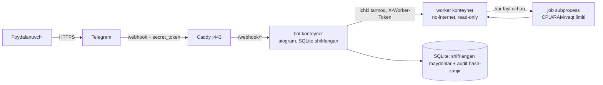

# CDR Bot: Hujjat tozalovchi Telegram boti

PDF, DOCX va XLSX fayllarni qabul qilib, **xavfsiz izolyatsiyalangan worker'da qayta quradi** (Content Disarm & Reconstruction),
zararli elementlarni olib tashlaydi va **aynan nima o'chirilganini** hisobotda ko'rsatadi.

> Capstone: Project 5 (Document sanitizer). Dizayn va tahdid modeli: [`docs/DESIGN.md`](docs/DESIGN.md)

## Nimalar zararsizlantiriladi

| Format | Olib tashlanadi |
|---|---|
| DOCX/DOCM, XLSX/XLSM | VBA makrolar, Excel 4.0 (XLM) makro varaqlari, OLE obyektlar, ActiveX, o'rnatilgan fayllar, **remote template** (`attachedTemplate`), tashqi fayl havolalari (`externalLink`, `frame`, `subDocument`, `altChunk`), Word **DDE/INCLUDETEXT/LINK/MACROBUTTON** maydonlari, xavfli Excel formulalari (DDE, `EXEC`, `[1]Sheet!A1`), data connection, customUI, add-in, `javascript:`/`file:`/UNC havolalar, metadata (muallif, kompaniya, eskiz, custom XML), spoof qilingan rasmlar |
| PDF | `/JavaScript`, `/JS`, `/OpenAction`, `/AA`, `/Launch`, `/SubmitForm`, `/GoToR`, XFA, RichMedia/Screen/Movie/Sound annotatsiyalari, o'rnatilgan fayllar (`/EmbeddedFiles`, `/AF`, FileAttachment), metadata (`/Info`, XMP) |

Oddiy veb-havolalar (`http`, `https`, `mailto`, `tel`) saqlanadi. Qabul qilinmaydi: eski `.doc/.xls` (OLE), parol bilan himoyalangan PDF, kengaytmasi mazmuniga mos kelmaydigan fayllar.

## Arxitektura



- **bot**: Telegram bilan gaplashadi, validatsiya/rate limit qiladi, fayl **mazmunini hech qachon o'zi parse qilmaydi**.
- **worker**: faqat `internal` Docker tarmog'ida (internetga chiqishi yo'q), `read_only`, `cap_drop: ALL`, non-root.
  Har fayl alohida `python -m worker.job` jarayonida (`RLIMIT_CPU/AS/FSIZE/NOFILE` + devor-soat timeout, jarayon guruhi o'ldiriladi).
- Dvigatel: [`worker/zipsafe.py`](worker/zipsafe.py) (zip bomba/traversal/overlap), [`worker/ooxml.py`](worker/ooxml.py) (DOCX/XLSX), [`worker/pdf_sanitizer.py`](worker/pdf_sanitizer.py) (PDF).

## Tezkor ishga tushirish

1. **Bot yaratish**: Telegram'da [@BotFather](https://t.me/BotFather) → `/newbot` → token oling.
2. **Admin ID**: [@userinfobot](https://t.me/userinfobot) dan o'z raqamli user ID'ingizni oling.
3. **Sirlar**:
   ```bash
   cp .env.example .env
   python scripts/gen_secrets.py     # chiqqan 3 qatorni .env ga ko'chiring
   # .env ni tahrirlang: BOT_TOKEN, ADMIN_IDS, WEBHOOK_BASE_URL, DOMAIN
   ```
4. **HTTPS manzil** (polling taqiqlangan, webhook HTTPS shart):
   - **VPS + domen**: domen A-yozuvini serverga yo'naltiring, `.env` da `WEBHOOK_BASE_URL=https://domeningiz`, `DOMAIN=domeningiz`:
     ```bash
     docker compose --profile proxy up -d --build
     ```
   - **Lokal sinov (domensiz)**: `docker compose up -d --build`, so'ng tunnel oching, masalan
     `cloudflared tunnel --url http://localhost:8080` yoki `ngrok http 8080`, chiqqan `https://...` manzilni `.env` dagi
     `WEBHOOK_BASE_URL` ga yozib, `docker compose up -d` ni qayta ishga tushiring (webhook start paytida o'rnatiladi).
5. Botga `/start` yuboring va `samples/` papkasidagi fayllarni sinab ko'ring.

Loglarni ko'rish: `docker compose logs -f bot worker`

## Buyruqlar

| Buyruq | Kim | Vazifa |
|---|---|---|
| `/start`, `/help`, `/policy` | hamma | yordam, nima o'chirilishi |
| fayl yuborish | hamma | tozalash + hisobot |
| `/stats` | admin | statistika |
| `/ban <id>`, `/unban <id>` | admin | foydalanuvchini cheklash |
| `/audit`, `/verifyaudit` | admin | audit log, hash-zanjir butunligi |

Adminlar **faqat raqamli user ID** bo'yicha tekshiriladi (`ADMIN_IDS`), username hech qachon ishlatilmaydi.

## Testlar va xavfsizlik tekshiruvlari

```bash
pip install -r requirements-dev.txt
python -m pytest -q                                   # 72 ta test
bandit -r bot worker -ll
pip-audit -r requirements-bot.txt -r requirements-worker.txt
python scripts/make_samples.py                        # samples/ ni qayta yaratish
```

`samples/` dagi fayllar **zararsiz soxta namunalar** (soxta `vbaProject.bin`, `example.com` havolalari, `alert()` JavaScript): demo uchun.

## Loyiha tuzilmasi

```
bot/       Telegram qismi (config, handlers, storage, security, worker_client, main)
worker/    Izolyatsiyalangan dvigatel (zipsafe, ooxml, pdf_sanitizer, engine, job, runner, server)
tests/     pytest (core, integratsiya, soxta Telegram sessiyasi)
docker/    Dockerfile'lar va Caddyfile
docs/      DESIGN.md (dizayn doc + tahdid modeli)
```
