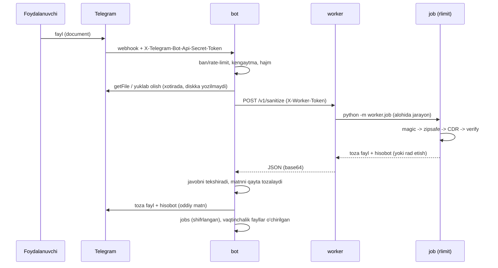

# Dizayn hujjati va tahdid modeli: CDR Bot (Project 5)

## 1. Maqsad va doira

Foydalanuvchi PDF/DOCX/XLSX yuboradi. Bot faylni **tahlil qilib "tozalamaydi", balki yangidan quradi**: faqat xavfsiz deb
tanilgan elementlar yangi faylga o'tadi (allowlist). Natijada tozalangan fayl va **nima o'chirilgani** haqida hisobot qaytariladi.

Doiradan tashqari: eski binar `.doc/.xls`, parol bilan himoyalangan PDF, PPTX, antivirus imzolari, kontent (matn) tahlili.

## 2. Komponentlar

| Komponent | Vazifa | Ishonch darajasi |
|---|---|---|
| Telegram | Foydalanuvchi ↔ bot | Tashqi, webhook `secret_token` bilan autentifikatsiya |
| Caddy (ixtiyoriy) | HTTPS terminatsiya, faqat `/webhook/*` | Edge tarmoq |
| `bot` konteyner | Validatsiya, rate limit, admin, baza, hisobot | Ishonchli kod, **hostile faylni parse qilmaydi** |
| `worker` konteyner | Ichki HTTP xizmat, job'larni ishga tushiradi | `internal` tarmoq, internetsiz, read-only, non-root |
| `job` subprocess | Haqiqiy parse + CDR | **Ishonchsiz kirish bilan to'qnashadigan yagona joy**; rlimit + timeout |
| SQLite | Foydalanuvchilar, ishlar (shifrlangan), audit (hash-zanjir) | `bot` konteynerida, hajm `bot-data` |

## 3. Ma'lumot oqimi

**Ishonch chegaralari:** (1) Internet ↔ bot; (2) bot ↔ worker; (3) worker ↔ job (ishonchsiz fayl faqat shu yerda ochiladi).

## 4. CDR algoritmi

**DOCX/XLSX** (`worker/ooxml.py`)
1. `zipsafe`: yozuvlar soni, jami/yozuv hajmi, siqish koeffitsienti, path traversal, dublikat/katta-kichik harf nomlari,
   shifrlangan yozuvlar, overlapping yozuvlar; sarlavhadagi hajmga ishonilmaydi (haqiqiy o'qilgan bayt sanaladi).
2. `_rels/.rels` dan boshlab munosabatlar grafi aylantiriladi. Faqat **erishiladigan** va xavfsiz qismlar o'tadi.
   Munosabat turi, kontent turi, qism nomi va rasm "magic" baytlari bo'yicha rad etiladi.
3. XML qismlarda: o'chirilgan `rId` larga havolalar olib tashlanadi, Word maydonlari (DDE/INCLUDETEXT/LINK/MACROBUTTON, bo'lingan `instrText` ham),
   Excel formulalari (DDE, `EXEC`, `[n]` tashqi havola, shared-formula bolalari bilan), xavfli nomlar (`Auto_Open`), `calcChain`.
4. `[Content_Types].xml` va barcha `.rels` **noldan quriladi**; ZIP deterministik vaqt belgisi bilan qayta yoziladi; makro-yoqilgan tur oddiyga o'tkaziladi.
5. **Tekshiruv (fail-closed):** zip qayta o'qiladi, barcha XML parse, barcha ichki havolalar mavjud, **idempotentlik** (ikkinchi o'tishda hech narsa topilmasligi shart),
   `python-docx` / `openpyxl` da haqiqatan ochiladi. Biri muvaffaqiyatsiz bo'lsa, foydalanuvchiga **fayl berilmaydi**.

**PDF** (`worker/pdf_sanitizer.py`): `pikepdf` obyekt modeli orqali iterativ (rekursiyasiz) aylanish; xavfli kalitlar/harakatlar/annotatsiyalar olib tashlanadi,
faqat `GoTo` va xavfsiz `URI` qoladi, `/Next` zanjirlari kesiladi, metadata o'chiriladi, fayl `qpdf` orqali qayta yoziladi (erishib bo'lmaydigan obyektlar tushadi).
Oqimlar hech qachon dekodlanmaydi. Tekshiruv: qayta ochish, sahifalar soni teng, taqiqlangan kalitlar yo'q.

## 5. Tahdid modeli (14 ta)

| # | Tahdid | Ta'sir | Yumshatish | Kod / test |
|---|---|---|---|---|
| T1 | **Zip bomba** (katta ratio, ko'p yozuv, jami hajm, overlapping "quine") | Xotira/CPU tugashi (DoS) | Yozuv/hajm/ratio limitlari, haqiqiy o'qishni cheklash, overlap tekshiruvi, rlimit `AS`/`CPU`, devor-soat timeout | `zipsafe.py`; `test_zipsafe.py`, `test_job_*_limit` |
| T2 | **Path traversal / zip smuggling** (`../`, dublikat nom) | Fayl tizimiga yozish, tekshiruvni aldash | Nom validatsiyasi; **hech narsa diskka ochilmaydi**, hammasi xotirada | `zipsafe._check_name`; testlar |
| T3 | **XXE / billion laughs** XML'da | Fayl o'qish, SSRF, DoS | `resolve_entities=False`, `no_network`, `load_dtd=False`; DOCTYPE bo'lsa **rad etiladi** | `ooxml.parse_xml`; `test_rejects_xxe_*`, `test_rejects_billion_laughs` |
| T4 | **Parser zaifligi (RCE)** libxml2/qpdf/pikepdf'da | Worker'ni egallash | Parse faqat job subprocess'da; worker internetsiz, read-only, non-root, `cap_drop: ALL`, `no-new-privileges`, mem/pids/cpu limit; patchlangan versiyalar (`pip-audit` CI'da) | `docker-compose.yml`, `job.py`, CI |
| T5 | **Makro/OLE/ActiveX/DDE/remote template/XLM** tozalashdan o'tib ketishi | Zararli kod yetkazish | Allowlist grafi, tur+nom+kontent bo'yicha rad, yetim qismlar o'chadi, **idempotent qayta skan** | `ooxml.py`; `test_malicious_*` |
| T6 | **PDF JS / Launch / OpenAction / embedded** | Kod bajarish | Kalit/harakat/annotatsiya olib tashlash + qayta yozish + qayta skan | `pdf_sanitizer.py`; `test_pdf.py` |
| T7 | **Kengaytma/mazmun spoofing** (`.pdf` aslida zip, polyglot rasm) | Tekshiruvni aylanib o'tish | Magic bayt bo'yicha aniqlash, kengaytma mosligi, rasm sarlavhasi tekshiruvi | `engine.sniff`; `test_invalid_uploads_*`, `test_spoofed_image_is_dropped` |
| T8 | **Hisobot orqali hujum** (RLO/bidi, bosiladigan zararli URL, Telegram markup injection) | Foydalanuvchini aldash | Matnlar tozalanadi (C* belgilar), URL'lar **defang** (`hxxp://x[.]com`), oddiy matn (parse_mode yo'q), uzunlik/qatorlar cheklangan, bot ham qayta tozalaydi | `report.py`, `texts.py`; `test_texts.py` |
| T9 | **Webhook soxtalashtirish** | Soxta update yuborish | HTTPS + `secret_token` (taqqoslash doimiy vaqtda), yo'l sirdan hosil qilingan, faqat `message` update'lari | `main.py`; `test_webhook_requires_secret_token` |
| T10 | **Adminlikni egallash** (username almashtirish) | Ban/audit'ga ruxsat | Faqat raqamli user ID allowlist; username `ADMIN_IDS` da rad etiladi; rad etilgan urinishlar audit'ga yoziladi | `config.py`, `handlers.py`; `test_admin_commands_*` |
| T11 | **Flood / resurs charchatish** | DoS | Per-user rate limit (xabar va fayl alohida), 1 foydalanuvchi = 1 parallel ish, global semafor, worker `busy` (503), hajm 20 MB, "juda tez" xabari ham limitlangan | `security.py`, `handlers.py`; `test_*rate_limit*` |
| T12 | **Sirlar oqishi** (token git/logda) | Botni egallash | `.env` + `.gitignore`, gitleaks CI (butun tarix), loglarda token/kalit redaction, worker `BOT_TOKEN`ni ko'rmaydi | `logging_setup.py`; `test_logs_never_contain_secrets` |
| T13 | **SQL injection / ma'lumot oshkor bo'lishi** | Baza buzilishi, maxfiy nomlar | Faqat parametrlangan SQL; fayl nomi va hisobot **Fernet** bilan shifrlangan; fayl mazmuni saqlanmaydi; 30 kundan keyin o'chiriladi | `storage.py`; `test_storage.py` |
| T14 | **Audit logni buzish** | Izlarni yo'qotish | Hash-zanjirli audit (`/verifyaudit`): o'zgartirish yoki o'chirish aniqlanadi | `storage.verify_audit_chain`; `test_audit_chain_detects_tampering` |

**SSRF:** bot foydalanuvchi bergan URL'ni **hech qachon yuklamaydi**. Hujjatdagi tashqi havolalar (remote template va h.k.) faqat o'chiriladi va defang qilib hisobotga yoziladi.
Parser'larda tarmoq o'chirilgan (`no_network`), worker esa internetsiz tarmoqda. Shuning uchun SSRF talabi "qo'llanilmaydi, dizayn bo'yicha oldi olingan".

## 6. Majburiy xavfsizlik bazasi (13 band) bo'yicha holat

| # | Talab | Qanday bajarilgan |
|---|---|---|
| 1 | Sirlar `.env`, `.gitignore` | `.env` ignore'da, `.env.example` faqat placeholder, gitleaks CI |
| 2 | Admin faqat user ID | `ADMIN_IDS` raqamli, username rad etiladi |
| 3 | Input validatsiya | kengaytma allowlist, hajm (Telegram'dan va yuklangandan keyin), magic bayt, fayl nomini tozalash |
| 4 | Rate limit | `SlidingWindowLimiter` (xabar + fayl), parallel cheklov |
| 5 | Injection yo'q | faqat `?` parametrlar; `eval/exec` yo'q; subprocess argument ro'yxati bilan, `shell=True` yo'q |
| 6 | SSRF | URL yuklanmaydi (yuqoriga qarang) |
| 7 | Ma'lumot minimallashtirish | mazmun saqlanmaydi, vaqtinchalik papka har doim o'chadi, retention 30 kun, loglarda sirlar yo'q |
| 8 | Xatolar | foydalanuvchiga umumiy xabar, tafsilot faqat logga (`test_worker_failure_gives_generic_message_only`) |
| 9 | Webhook + HTTPS + secret_token | polling yo'q; `https://` majburiy (config rad etadi) |
| 10 | Docker non-root, read-only | `user`, `read_only`, `tmpfs`, `cap_drop`, `no-new-privileges` |
| 11 | CI | `.github/workflows/ci.yml`: pytest, bandit, gitleaks, pip-audit, docker build |
| 12 | Ishonchsiz fayllar alohida worker'da | `worker` konteyner + job subprocess + CPU/RAM/vaqt limiti |
| 13 | Maxfiy maydonlar shifrlangan + audit | Fernet (`filename_enc`, `report_enc`), hash-zanjirli audit log |

## 7. Ma'lum cheklovlar (halol ro'yxat)

- **Haqiqiy Microsoft Office'da** ochilish sinalmagan: tekshiruv `python-docx`/`openpyxl`, LibreOffice va ISO XSD validator orqali qilingan.
- Excel'da shared-formula, `localSheetId` kabi murakkab holatlar uchun himoya bor, lekin real hayotdagi barcha ekzotik fayllar sinalmagan.
- Metadata `docProps`/`/Info`/XMP olib tashlanadi; hujjat **ichidagi** muallif izlari (izoh mualliflari, `rsid`) o'chirilmaydi.
- Raqamli imzolar tozalashdan keyin yaroqsiz bo'ladi (olib tashlanadi va hisobotda ko'rsatiladi).
- Rate limiter xotirada (bitta jarayon): bir nechta bot nusxasi bo'lsa Redis kerak bo'ladi.
- `docker compose` va GitHub Actions bu hujjatni yozish paytida **ishga tushirilib ko'rilmagan** (sandbox'da Docker yo'q); kod, testlar va CI bosqichlari lokal tekshirilgan.
